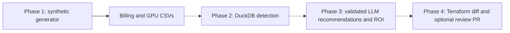

# GPU FinOps Detective

A local-first project for finding wasted GPU cloud spend by joining billing
records with hardware telemetry, then producing evidence-backed optimization
proposals. The long-term workflow includes a bounded LLM assistant and reviewable
Terraform changes.

**Current status: Phase 1 is implemented.** The demo generates reproducible
synthetic data and a ground-truth manifest. Detection, LLM recommendations,
Terraform editing, and GitHub PR creation are planned, not yet implemented.

## Run the local demo

Requires Python 3.12 or newer. There are no Python dependencies in Phase 1.
From the repository root:

```sh
make demo
make test
```

Make is optional. On Windows PowerShell, or any system without Make:

```sh
python data/generator.py
python -m unittest discover -s tests -v
```

If your interpreter is named `python3`, use `make demo PYTHON=python3`.
With uv installed, `uv run python data/generator.py` is another option; uv may
need network access to provision Python on the first run.

For an isolated container run:

```sh
docker compose run --build --rm demo
```

The image build may need internet access. The generator container runs without
network access. On Linux, files written through the bind mount may be owned by
root; use the Python command if you prefer files owned by your local user.

All modes write `data/generated/`, which is excluded from Git. Rerunning replaces
the three generated files. No cloud credentials, physical GPU, LLM account, or
Terraform installation is required. No infrastructure is provisioned.

## What the dataset contains

Defaults: seed **42**, **30 days**, hourly aggregates from **2026-11-02 00:00 UTC**
through **2026-12-02 00:00 UTC**, end exclusive. Scheduling uses UTC throughout.

| Artifact | Grain | Default rows |
|---|---|---:|
| `billing.csv` | One resource per billed hour | 1,440 |
| `dcgm_telemetry.csv` | One physical GPU per hour | 11,520 |
| `manifest.json` | Configuration, resource mapping, and injected ground truth | One document |

Two synthetic AWS `p4d.24xlarge` nodes each have eight A100 GPUs and 40 GiB of
VRAM per GPU, matching the [AWS hardware specification](https://docs.aws.amazon.com/ec2/latest/instancetypes/ac.html).
The inference node serves `recommendation-llm`; it receives traffic weekdays
06:00–18:00 UTC and is idle overnight and on weekends. The healthy control
remains busy continuously. Both retain 70–80% of each GPU's VRAM. Idle samples
have zero SM activity, tensor activity, and requests; active tensor activity is
25–65%.

Billing contains provider/account/region/resource identity, interval bounds,
instance type, service/environment tag columns, usage, rate, currency, and cost.
Telemetry contains the same identity, GPU index/UUID, compute percentages,
memory, and per-GPU requests per second. These are normalized synthetic records,
not native AWS billing exports or raw Prometheus/DCGM scrapes. `_mb` memory
columns use **MiB**; percentages use **0–100**, not fractions. Timestamps label
the start of each hourly aggregate.

Join on provider, account, region, resource ID, and hour **after aggregating GPU
telemetry to the instance**. One billing row must not be charged eight times.
The control node exists only in synthetic data; the Terraform fixture represents
the targeted inference node. The manifest records that mapping.

### Expected fixture results

The fixture uses **$32.77 per instance-hour**, an illustrative rate, **not a live
AWS price or a verified pricing snapshot**. It excludes storage, network, tax,
discounts, and commitments. Money is calculated with decimal arithmetic.

| Ground-truth quantity | Expected value |
|---|---:|
| Total billed compute, both nodes | $47,188.80 |
| Injected idle instance-hours | 456 |
| Compute cost during all injected idle hours | $14,943.12 |
| Idle hours in contiguous intervals of at least 12 hours | 444 |
| Compute cost eligible for the planned 12-hour rule | $14,549.88 |

The first and last idle intervals are only six hours long inside this dataset,
so a detector requiring 12 complete consecutive hours cannot flag them. The
manifest contains disjoint intervals and distinguishes both totals. This is
test ground truth, not an anomaly report or guaranteed recoverable savings.

Runtime, precision/recall, and LLM ROI benchmarks will be measured once those
stages exist; no performance results are claimed yet.

### Customize generation

```sh
python data/generator.py --days 7 --start-date 2026-11-02 --seed 7 --output-dir data/generated
python data/generator.py --hourly-rate 20.00
```

Days must be 1–366. The optional rate must be positive USD with at most two
decimal places. Identical arguments produce byte-identical outputs. The seed
changes telemetry variation; it does not change the idle schedule or pricing.

## Sample Terraform

[`data/sample_infra/main.tf`](data/sample_infra/main.tf) defines one always-on,
private GPU inference node tagged `service=recommendation-llm`. It uses required
inputs for an existing GPU-ready AMI, private subnet, security groups, and instance
profile; it does not install or deploy a model. The intentionally excessive
always-on allocation creates the target for later remediation.

The fixture follows the [Terraform AWS instance resource](https://registry.terraform.io/providers/hashicorp/aws/latest/docs/resources/instance).
Terraform is not called by the demo. Optional configuration checks, with
Terraform installed, are:

```sh
terraform -chdir=data/sample_infra fmt -check
terraform -chdir=data/sample_infra init -backend=false
terraform -chdir=data/sample_infra validate
```

Initialization downloads the provider and requires network access; validation
does not provision infrastructure. These checks do not prove deployment safety
or workload performance. The example is not a production deployment module.

## Architecture and roadmap

See the [Mermaid architecture flows](docs/ARCHITECTURE.md) and the
[implementation plan](docs/PLAN.md) for implemented versus planned components.



The intended stack grows incrementally: Python and CSV now; DuckDB for analysis;
Pydantic for evidence and recommendation contracts; PostgreSQL for persistent
workflow state; FastAPI for job submission and review; and a separate worker for
pipeline execution. Parquet can replace CSV when ingestion volume warrants it.

`make demo` will remain the offline entry point as later phases are implemented.
**`make prod` is reserved and currently exits with an error.** Future production
mode will use real ingestion/storage adapters and explicit configuration, sharing
the same analysis core. Initial production targets are AWS S3, RDS PostgreSQL,
ECS/Fargate, SQS, and scheduled execution. There is no production deployment yet.

## Repository layout

```text
.
├── Makefile                   # demo, test, and reserved prod entry points
├── Dockerfile
├── docker-compose.yml         # Isolated Phase 1 generator
├── pyproject.toml             # Python requirements; no dependencies yet
├── data/
│   ├── generator.py
│   └── sample_infra/main.tf
├── docs/
│   ├── ARCHITECTURE.md         # Mermaid diagrams
│   └── PLAN.md                 # Acceptance criteria and production path
└── tests/test_generator.py
```

## License

See [LICENSE](LICENSE).
