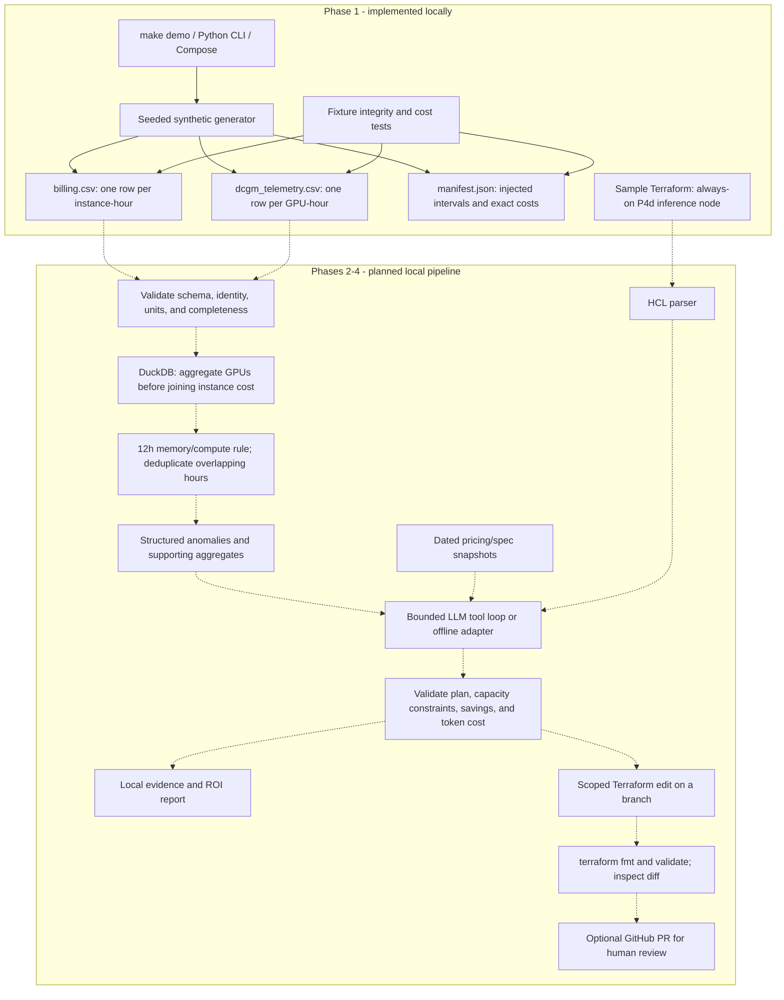
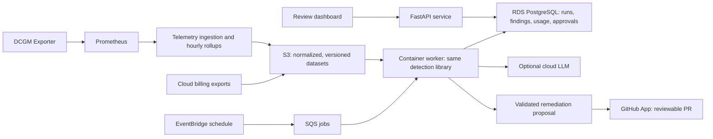

# Architecture flow

Solid arrows show the implemented Phase 1 path. Dashed arrows show planned
components. The ground-truth manifest is a test oracle, not detector input.

## Future production boundary

These are design targets; no production resources or connectors exist yet.
Billing remains delayed accounting data even when hardware telemetry is fresh.

Keep cloud ingestion, pricing, model calls, and remediation behind separate
interfaces. Raw data stays outside the model context. Detection and cost math
must work with the LLM disabled. Production will add tenant/account isolation,
durable job retries, credentials management, audit records, and operational
monitoring before enabling live execution.

